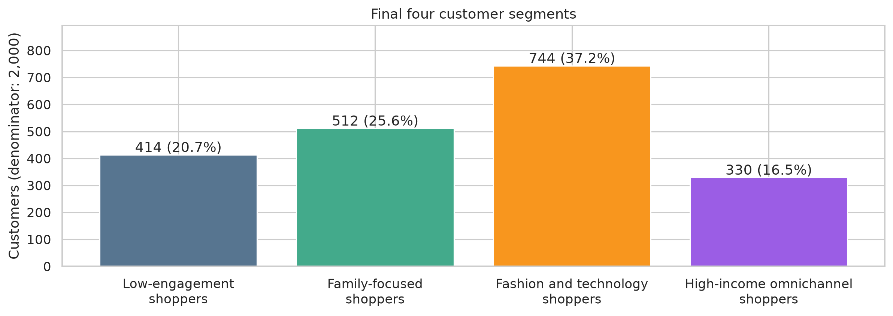
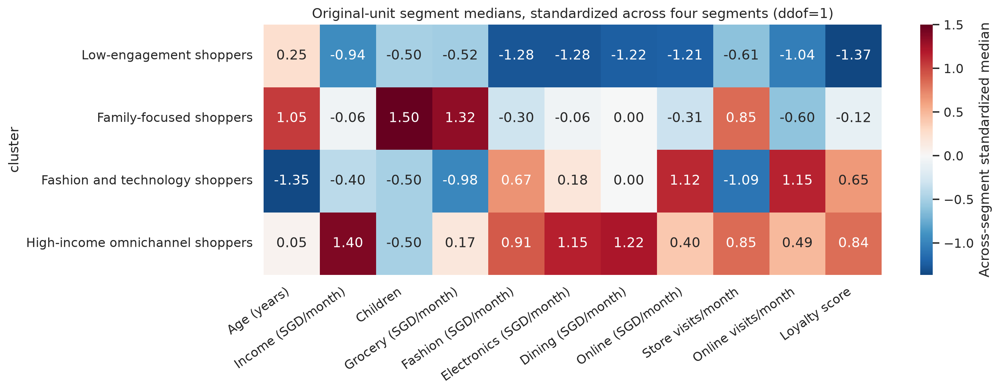

# Retail Customer Segmentation and Marketing Strategy

**Marketing and customer analytics | Python · Data quality · Statistical modeling · Reproducible reporting**

This retail case study analyzes **2,000 customers** using purchasing capacity, category spending and channel visits. PCA and clustering identify customer patterns, while a reproducible Python workflow generates profiles, model comparisons and business recommendations.

*Individual academic project using course-provided data and a simulated retail business brief. Numerical findings are verified; marketing actions are proposals for future testing.*

- **Business question:** Which customer groups warrant different offers, and which retailer channels best match their observed shopping patterns?

- **Key finding:** the largest segment contains **744 customers (37.2%)**, with median online spending of **SGD 900/month** and **13 online visits versus 2 store visits/month**. The four-segment solution also distinguishes family-focused grocery purchasing from higher-income omnichannel activity, supporting differentiated marketing hypotheses despite stronger internal metrics at K=3.

- **Project contribution:** validate customer data, prepare eight clustering features, retain five principal components, compare K-Means and Ward clustering, and translate original-unit customer profiles into proposed marketing pilots with defined KPIs.

- **Core strengths:** Python data analysis, data-quality controls, multivariate analysis, critical model evaluation, reproducible reporting, and communication of evidence-based business decisions.

[Read the business case](reports/customer_segmentation_case_study.md) · [Explore the complete Notebook](notebooks/customer_segmentation.ipynb) · [View the data dictionary](data/README.md)

## 1. Business Context and Objectives

In this simulated brief, an omnichannel retailer is planning category offers, customer engagement and membership benefits. A single broad audience gives the marketing team limited guidance on product relevance and channel choice. The analyst's task is to create evidence-based customer profiles that can support differentiated pilot decisions.

| Business pain point | Objective | Project deliverable |
| --- | --- | --- |
| Different purchasing needs are hidden within a broad audience | Identify distinct spending patterns | Four customer profiles with counts, shares and original-unit summaries |
| Offer and channel choices lack a clear customer-level rationale | Connect observed category and channel patterns to actions | Segment-specific marketing hypotheses and proposed success metrics |
| Choosing more groups increases campaign-planning complexity | Justify the practical value of K=4 versus K=3 | Model comparison, stability evaluation and profile-based reasoning |

The intended stakeholder is a marketing or customer-insights manager choosing audiences, relevant offers and the first pilot. The business case connects each recommendation to observed spending or channel behavior. A proposed customer-level treatment/control comparison would close the decision loop once transaction, exposure and cost data are available; campaign effectiveness has not been measured.

## 2. Data and Analytical Approach

The [included dataset](data/raw/customer_segmentation.csv) contains **2,000 customers and 15 fields**, with one row per customer. It combines demographics, monthly income, category/online spending, monthly channel visits and a constructed loyalty score. Income and approximate average monthly spending are in **SGD**; visits are monthly averages. See the [data dictionary](data/README.md) for definitions.

| Analytical stage | Method | Purpose |
| --- | --- | --- |
| Data audit | Schema, types, missingness, duplicates, categories and plausibility checks | Establish what can be analyzed and flag unresolved source-quality issues |
| Preprocessing | Median/mean imputation, `log1p` for income/store visits, StandardScaler | Prepare eight features for distance-based comparison while preserving original units for profiles |
| Dimensionality reduction | PCA; five retained components explain **81.57%** of variance | Summarize correlated purchasing and channel patterns |
| Segmentation and evaluation | K-Means K=2–10; Euclidean/Ward K=2–8; internal metrics and ARI/NMI stability | Assess separation, consistency and model-selection tradeoffs |
| Business interpretation | Original-unit medians, demographic proportions and membership comparisons | Translate model output into interpretable audiences and testable actions |

Income is a purchasing-capacity feature. Demographics are used for subsequent profiles. Loyalty is excluded from clustering because it is constructed from spending and visits, reducing redundancy. Online spending may overlap category spending, so the five spending columns are not added into a revenue measure.

### Reproducible reporting

One command generates aggregate profile tables, model diagnostics and English figures from the same reusable functions used by the Notebook. The workflow validates schema and customer identity, preserves original units, checks segment totals and proportion denominators, and fails clearly when input checks are not met. This provides reviewable evidence for both a business reader and a technical interviewer.

## 3. Key Findings and Business Insights

| Segment | Customers | Share | Median income (SGD/month) | Store visits/month | Online visits/month |
| --- | ---: | ---: | ---: | ---: | ---: |
| Low-engagement shoppers | 414 | 20.7% | 3,550 | 3 | 3 |
| Family-focused shoppers | 512 | 25.6% | 8,050 | 6 | 5 |
| Fashion and technology shoppers | 744 | 37.2% | 6,300 | 2 | 13 |
| High-income omnichannel shoppers | 330 | 16.5% | 15,550 | 6 | 10 |

Visit and income values are within-segment medians after imputation; shares use all 2,000 customers.



- **Online targeting:** the largest segment represents **37.2%** of customers, with median online spending of **SGD 900/month** and **13 online visits versus 2 store visits**. This supports testing on-platform category recommendations.
- **Different category strategies:** family-focused shoppers have median grocery spending of **SGD 1,000/month**. High-income omnichannel shoppers have median dining spending of **SGD 900/month** and substantial activity in both channels. These patterns support separate grocery and cross-channel offer hypotheses.
- **Repeat-purchase hypothesis:** low-engagement shoppers account for **20.7%** of customers and have low spending and visits. A relevant repeat-visit offer is a testable proposal; the snapshot does not establish churn or likely response.



The heatmap standardizes each feature's four segment medians using sample SD. It shows relative profile differences; the [case study](reports/customer_segmentation_case_study.md#customer-profiles) supplies original-unit spending values.

**Why four segments?** K=3 has stronger internal metrics. K=4 makes the family/grocery and higher-income omnichannel patterns separately visible, potentially supporting different offers. Its additional complexity should earn its place through later business testing.

| K | Silhouette | Calinski-Harabasz | Davies-Bouldin | Minimum cluster share |
| --- | ---: | ---: | ---: | ---: |
| 3 | 0.336 | 1,011.484 | 1.164 | 21.7% |
| 4 | 0.326 | 923.144 | 1.222 | 16.5% |

Candidate and final K-Means partitions agree at K=3 and K=4. K=4 subsampling ARI/NMI is **0.974/0.961** under the stated protocol. Ward provides a second-method comparison; its silhouette sampling and stability reference scheme differ, so cross-method score gaps require care. The [complete Notebook](notebooks/customer_segmentation.ipynb) details these protocols.

## 4. Marketing Recommendations and Validation

| Segment | Proposed action and channel | Proposed success metric |
| --- | --- | --- |
| Low-engagement shoppers | Relevant repeat-visit offer through a consented retailer channel or in-store checkout | Repeat purchase rate |
| Family-focused shoppers | Grocery bundles or replenishment reminders through stores and consented retailer messaging | Grocery repeat purchase rate |
| Fashion and technology shoppers | Category recommendations or relevant bundles on the online platform | Category-purchase conversion |
| High-income omnichannel shoppers | Cross-channel membership benefits or service options across stores and the online platform | Cross-channel repeat purchase rate |

An online recommendation pilot is a proposed starting point because the largest group has a clear channel pattern. Define category-purchase conversion as customers buying the promoted category divided by all eligible customers assigned to each arm during the same window. Compare randomized treatment/control groups, report uncertainty and check incremental margin once costs are available. The [measurement plan](reports/customer_segmentation_case_study.md#proposed-kpi-definitions) specifies KPI numerators, denominators and additional data requirements. It is a proposed test, not an executed experiment or measured uplift.

## 5. Limitations and Next Steps

- **Data quality:** four fields each contain 50 missing values (2.5%); no duplicate rows or IDs were found. Income of SGD 999,999 and store visits of 100/month are unverified extremes retained as supplied. Central-value imputation and log transformation have limitations.
- **Scope:** the sampling frame and observation period are undocumented. This cross-sectional dataset cannot establish churn, lifetime value, profitability or campaign effects; online spending may overlap category spending.
- **Model interpretation:** K=4 is a working segmentation, not evidence of natural customer types. Stability retains full-sample preprocessing, and method-comparison protocols differ. Demographic proportions describe groups without establishing motives or platform preferences.

Next steps are to verify source extremes, assess segment persistence with longitudinal purchases, harmonize comparison protocols and test whether differentiated offers improve outcomes. The current deliverable is a reproducible analytical case study; deployment and ongoing monitoring remain future work.

## 6. Repository navigation

### 6.1 Project Structure

```text
retail-customer-segmentation/
├── README.md
├── requirements.txt
├── .gitignore
├── data/
│   ├── README.md
│   └── raw/
│       └── customer_segmentation.csv
├── notebooks/
│   └── customer_segmentation.ipynb
├── src/
│   ├── __init__.py
│   ├── config.py
│   ├── data.py
│   ├── preprocessing.py
│   ├── clustering.py
│   ├── profiling.py
│   ├── visualization.py
│   └── run_analysis.py
├── reports/
│   ├── customer_segmentation_case_study.md
│   ├── figures/
│   └── tables/
└── tests/
    └── test_analysis_integrity.py
```

### 6.2 File Navigation

| Location | Contents |
| --- | --- |
| [Notebook](notebooks/customer_segmentation.ipynb) | Complete English analysis and executed outputs |
| [Case study](reports/customer_segmentation_case_study.md) | Business interpretation, technical evidence and testable proposals |
| [src](src/) | Data checks, preprocessing, PCA, clustering, stability, profiling and figures |
| [Aggregate tables](reports/tables/) | Metrics, original-unit medians/means, category proportions and contingencies |
| [Figures](reports/figures/) | Reproducible English PNGs |
| [Integrity tests](tests/test_analysis_integrity.py) | Schema, identity, original units, finite values, counts, shares and name mapping |

## 7. How to Run

Use **Python 3.12**. Download or clone this repository and open a terminal in its root directory.

Create a virtual environment:

```sh
python -m venv .venv
```

Activate it on Windows PowerShell with `.\.venv\Scripts\Activate.ps1`, or on macOS/Linux with `source .venv/bin/activate`. Then install the dependencies and run:

```sh
python -m pip install -r requirements.txt
python -m src.run_analysis
python -m jupyterlab notebooks/customer_segmentation.ipynb
```

In JupyterLab, select the virtual environment's Python kernel and run all Notebook cells in order. The Notebook runs the complete analysis independently of the command-line step. Generated tables and figures are saved in `reports/`; the source CSV is unchanged.

Tested on Windows with Python 3.12.13. To check analysis integrity, run `python -m unittest discover -s tests -v`. To use a different data location, pass `--data path/to/customer_segmentation.csv`.

## 8. Technologies

| Tool or method | Professional skill demonstrated | Project evidence |
| --- | --- | --- |
| **Python, pandas and NumPy** | Customer-data validation, imputation, feature preparation and original-unit aggregation | [Data checks](src/data.py), [preprocessing](src/preprocessing.py) and [profiles](src/profiling.py) |
| **scikit-learn and SciPy** | Standardization, PCA, K-Means and Euclidean/Ward clustering; critical comparison of model choices | [Clustering functions](src/clustering.py) and [complete analysis](notebooks/customer_segmentation.ipynb) |
| **Statistical model evaluation** | Internal metrics, resampling/initialization agreement, aligned observations and label-invariant comparisons | [Candidate metrics](reports/tables/kmeans_candidates.csv) and [stability results](reports/tables/kmeans_stability.csv) |
| **Matplotlib and seaborn** | Readable data visualization with explicit units, proportions and methodological context | [Visualization functions](src/visualization.py) and [exported figures](reports/figures/) |
| **Modular Python and JupyterLab** | Repeatable report generation, explicit settings, pinned dependencies and focused data-integrity checks | [Command-line workflow](src/run_analysis.py), [requirements](requirements.txt) and [tests](tests/test_analysis_integrity.py) |
| **Marketing and business analysis** | Connecting behavioral evidence to audience, offer and channel decisions; communicating tradeoffs | [Business case](reports/customer_segmentation_case_study.md#key-findings-and-business-implications) |
| **Measurement and experiment planning** | Specifying KPI eligibility, numerators/denominators, customer-level randomization and decision criteria | [Proposed measurement design](reports/customer_segmentation_case_study.md#proposed-kpi-definitions) |

The implemented workflow covers descriptive customer analytics and local reporting. Experiment planning is a documented proposal. SQL, Spark, warehouse systems, predictive recommendations and causal estimation are not implemented in this repository.
